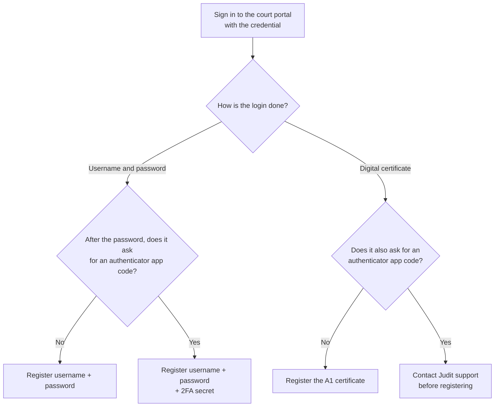
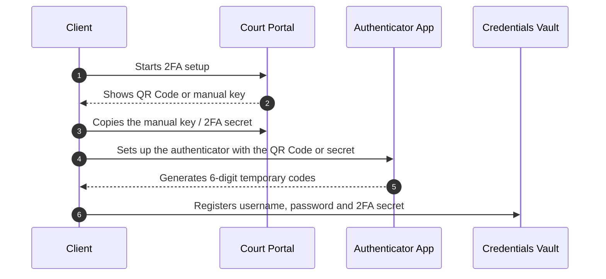
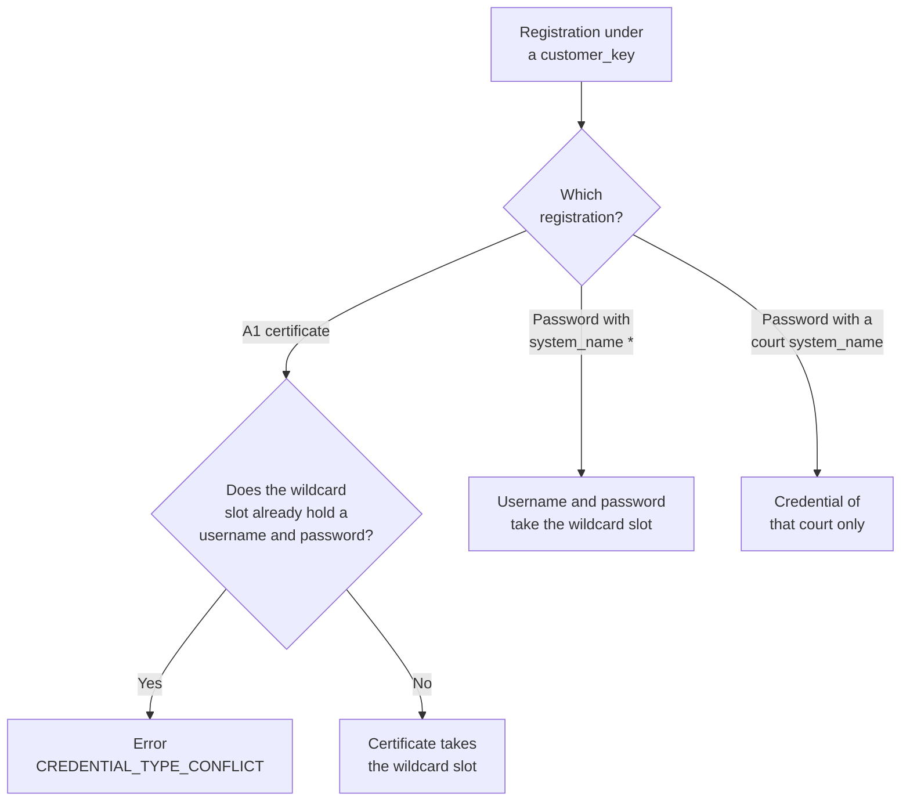
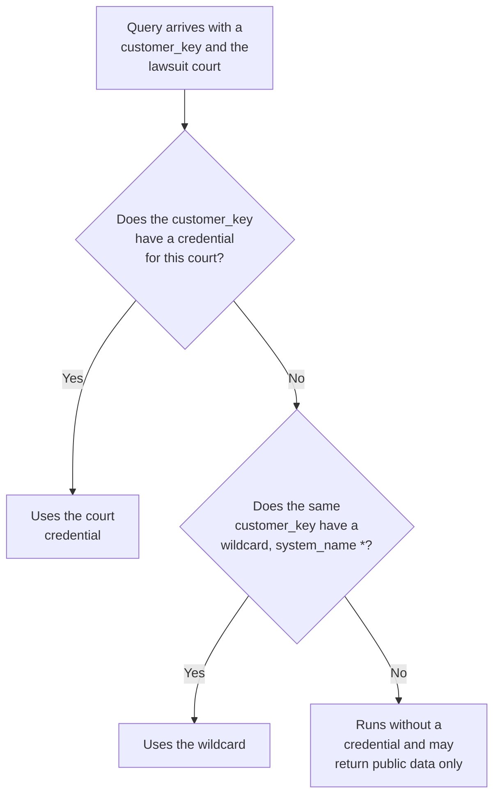

export const VaultAnimation = () => (
  <iframe sandbox="allow-scripts" scrolling="no" style={{width:'100%',height:'540px',border:'none',borderRadius:'12px',display:'block',margin:'20px 0'}} srcDoc={`<!doctype html><html><head><meta charset="utf-8"><style>*{margin:0;padding:0;box-sizing:border-box}html,body{width:100%;height:100%;overflow:hidden;background:#090c0d}canvas{display:block;width:100%;height:100%}</style></head><body><canvas id="c"></canvas><script>(function(){
var A='#4FD1C5',J='#1FC16B',T='#E0A82E',P='#C084FC',M='#7A8599';
var BG='#090c0d',TXT='#e5e7eb',NF='#111827',PT2='#0a1020';
var TOTAL=30.0;
var XP={cli:0.09,judit:0.38,cofre:0.65,court:0.90};
var NW=86,NH=42;
var FLOWS=[
  {id:'reg',title:'① Credential Registration',sub:'Configure once per court',col:A,ts:1,te:14,act:['cli','cofre','court'],steps:[
    {fr:'cli',to:'court',label:'validates credential',note:'creates user/password in the portal',col:T,ts:1.5,te:2.3,yp:0.35},
    {fr:'cli',to:'cofre',label:'POST /credentials',note:'{system_name, customer_key, password}',col:P,ts:3.2,te:4.0,yp:0.52},
    {fr:'cofre',to:'cli',label:'CREDENTIAL_CREATED',note:'encrypted credential',col:P,ts:4.5,te:5.3,yp:0.68}]},
  {id:'use',title:'② Using in a Query',sub:'Reference customer_key in the request',col:J,ts:16,te:29,act:['cli','judit','cofre','court'],steps:[
    {fr:'cli',to:'judit',label:'POST /requests',note:'{customer_key}',col:A,ts:16.5,te:17.3,yp:0.28},
    {fr:'judit',to:'cofre',label:'fetches credential',note:'',col:P,ts:17.8,te:18.6,yp:0.40},
    {fr:'cofre',to:'judit',label:'credential found',note:'',col:P,ts:19.1,te:19.9,yp:0.52},
    {fr:'judit',to:'court',label:'authenticated access',note:'secret lawsuit',col:T,ts:20.4,te:21.2,yp:0.64},
    {fr:'court',to:'judit',label:'restricted data',note:'',col:J,ts:21.7,te:22.5,yp:0.76},
    {fr:'judit',to:'cli',label:'response_data',note:'',col:J,ts:23.0,te:23.8,yp:0.88}]}
];
var NODES=[{id:'cli',label:'Your App',col:A},{id:'judit',label:'Judit API',col:J},{id:'cofre',label:'Vault',col:P},{id:'court',label:'Court',col:T}];
var cv=document.getElementById('c');
function setup(){var dpr=Math.min(window.devicePixelRatio||1,2),r=cv.getBoundingClientRect(),W=r.width||window.innerWidth,H=r.height||window.innerHeight;cv.width=Math.max(1,W*dpr);cv.height=Math.max(1,H*dpr);var ctx=cv.getContext('2d');ctx.setTransform(dpr,0,0,dpr,0,0);return{ctx:ctx,w:W,h:H};}
function ease(t){return t<0.5?2*t*t:1-Math.pow(-2*t+2,2)/2;}
function rr(ctx,x,y,w,h,r){ctx.beginPath();ctx.moveTo(x+r,y);ctx.arcTo(x+w,y,x+w,y+h,r);ctx.arcTo(x+w,y+h,x,y+h,r);ctx.arcTo(x,y+h,x,y,r);ctx.arcTo(x,y,x+w,y,r);ctx.closePath();}
function gx(n,w){return n==='cli'?w*XP.cli:n==='judit'?w*XP.judit:n==='cofre'?w*XP.cofre:w*XP.court;}
function eg(fr,to,w){var fx=gx(fr,w),tx=gx(to,w),d=tx>fx?1:-1;return{x1:fx+d*NW/2,x2:tx-d*NW/2,d:d};}
function dPkt(ctx,x,y,lbl,col){var pw=Math.max(36,lbl.length*6+14),ph=20;ctx.save();ctx.shadowColor=col;ctx.shadowBlur=18;rr(ctx,x-pw/2,y-ph/2,pw,ph,5);ctx.fillStyle=col;ctx.fill();ctx.shadowBlur=0;ctx.fillStyle=PT2;ctx.font='bold 9px monospace';ctx.textAlign='center';ctx.textBaseline='middle';ctx.fillText(lbl,x,y+0.5);ctx.restore();}
function draw(ctx,w,h,t){
  var ct=t%TOTAL;
  ctx.fillStyle=BG;ctx.fillRect(0,0,w,h);
  var fl=null;for(var i=0;i<FLOWS.length;i++){if(ct>=FLOWS[i].ts&&ct<FLOWS[i].te){fl=FLOWS[i];break;}}
  var nodeY=h*0.21;
  for(var i=0;i<NODES.length;i++){var n=NODES[i],lx=gx(n.id,w),ia=!fl||(fl.act.indexOf(n.id)>=0);ctx.save();ctx.strokeStyle=n.col;ctx.globalAlpha=ia?0.35:0.07;ctx.lineWidth=1;ctx.setLineDash([4,7]);ctx.beginPath();ctx.moveTo(lx,nodeY+NH/2);ctx.lineTo(lx,h*0.95);ctx.stroke();ctx.restore();}
  if(fl){ctx.save();ctx.fillStyle=fl.col;ctx.font='bold 13px Inter,system-ui,sans-serif';ctx.textAlign='center';ctx.textBaseline='middle';ctx.fillText(fl.title,w/2,h*0.055);ctx.fillStyle=M;ctx.font='10.5px Inter,system-ui,sans-serif';ctx.fillText(fl.sub,w/2,h*0.118);ctx.restore();}
  if(fl){for(var si=0;si<fl.steps.length;si++){var s=fl.steps[si],sy=h*s.yp,e=eg(s.fr,s.to,w),x1=e.x1,x2=e.x2,d=e.d,clx=(x1+x2)/2;var state=ct<s.ts?'pre':ct>s.te?'done':'live',alpha=state==='pre'?0.10:state==='done'?0.55:1.0;ctx.save();ctx.globalAlpha=alpha;ctx.strokeStyle=s.col;ctx.lineWidth=1.5;ctx.setLineDash([]);ctx.beginPath();ctx.moveTo(x1,sy);ctx.lineTo(x2,sy);ctx.stroke();ctx.fillStyle=s.col;ctx.beginPath();ctx.moveTo(x2,sy);ctx.lineTo(x2-d*7,sy-4);ctx.lineTo(x2-d*7,sy+4);ctx.closePath();ctx.fill();ctx.fillStyle=TXT;ctx.font='bold 10px monospace';ctx.textAlign='center';ctx.textBaseline='bottom';ctx.fillText(s.label,clx,sy-4);if(s.note){ctx.fillStyle=M;ctx.font='9px monospace';ctx.fillText(s.note,clx,sy-16);}ctx.restore();if(state==='live'){var p=ease((ct-s.ts)/(s.te-s.ts));dPkt(ctx,x1+(x2-x1)*p,sy+14,s.label,s.col);}}}
  for(var i=0;i<NODES.length;i++){var nd=NODES[i],px=gx(nd.id,w),ia=!fl||(fl.act.indexOf(nd.id)>=0);ctx.save();ctx.globalAlpha=ia?1:0.18;if(ia){ctx.shadowColor=nd.col;ctx.shadowBlur=14;}rr(ctx,px-NW/2,nodeY-NH/2,NW,NH,8);ctx.fillStyle=NF;ctx.fill();ctx.shadowBlur=0;ctx.strokeStyle=ia?nd.col:'rgba(255,255,255,0.10)';ctx.lineWidth=ia?1.8:1;ctx.stroke();ctx.fillStyle=ia?nd.col:M;ctx.font='bold 11px Inter,system-ui,sans-serif';ctx.textAlign='center';ctx.textBaseline='middle';ctx.fillText(nd.label,px,nodeY);ctx.restore();}
  for(var f=0;f<FLOWS.length;f++){var ia=fl&&fl.id===FLOWS[f].id;ctx.save();ctx.beginPath();ctx.arc(w/2+(f-0.5)*24,h*0.965,ia?5:3,0,Math.PI*2);ctx.fillStyle=ia?FLOWS[f].col:'rgba(255,255,255,0.18)';ctx.fill();ctx.restore();}
}
var dim,t0;
function loop(){var t=(performance.now()-t0)/1000;draw(dim.ctx,dim.w,dim.h,t);requestAnimationFrame(loop);}
window.addEventListener('load',function(){dim=setup();t0=performance.now();loop();});
window.addEventListener('resize',function(){dim=setup();});
cv.addEventListener('click',function(e){var r=cv.getBoundingClientRect(),cx=e.clientX-r.left,cy=e.clientY-r.top;for(var f=0;f<FLOWS.length;f++){var dx=cx-(dim.w/2+(f-(FLOWS.length-1)/2)*24),dy=cy-dim.h*0.962;if(dx*dx+dy*dy<=144){t0=performance.now()-FLOWS[f].ts*1000;break;}}});
cv.addEventListener('mousemove',function(e){var r=cv.getBoundingClientRect(),cx=e.clientX-r.left,cy=e.clientY-r.top,over=false;for(var f=0;f<FLOWS.length;f++){var dx=cx-(dim.w/2+(f-(FLOWS.length-1)/2)*24),dy=cy-dim.h*0.962;if(dx*dx+dy*dy<=144){over=true;break;}}cv.style.cursor=over?'pointer':'default';});
})()</script></body></html>`} />
);

The **Credentials Vault** stores, encrypted, the credentials that lawyers use to authenticate in Brazilian courts, in three login methods you register yourself: username and password; username, password and an authenticator app 2FA secret; or an A1 digital certificate. With this, Judit can access lawsuits under **judicial secrecy** on behalf of the lawyer, without your application ever storing or transmitting the password.

> 🤖 Base endpoint: `https://crawler.prod.judit.io/credentials`. Register once and reference it later in queries via `credential.customer_key`.

## When to use

<CardGroup cols={2}>
  <Card title="Access to secret lawsuits" icon="lock">
    Required to query civil and labor lawsuits under judicial secrecy.
  </Card>
  <Card title="Multi-tenant for firms" icon="users">
    Use `customer_key` to separate credentials per lawyer/client of the firm.
  </Card>
  <Card title="LGPD/GDPR compliance" icon="shield-halved">
    Passwords, secrets and certificates are stored encrypted in a dedicated vault and are never returned by the API.
  </Card>
  <Card title="Wildcard credential" icon="asterisk">
    Register `"system_name": "*"` to cover the systems that have no specific credential in the same `customer_key`.
  </Card>
  <Card title="A1 digital certificate" icon="certificate" href="#registering-a-credential-with-a-digital-certificate-a1">
    Courts that require certificate login use the `POST /credentials/certificate` route.
  </Card>
</CardGroup>

## How it works

<Steps>
  <Step title="Identify how the court handles login">
    Sign in to the court portal with the credential you will use and note what it asks for: password, authenticator app code or digital certificate.
  </Step>
  <Step title="Register the credential in the vault">
    Send the vault exactly what the court asks for, tied to a `customer_key` you choose.
  </Step>
  <Step title="Check the registration">
    Call `GET /credentials` and confirm the credential shows as `active`.
  </Step>
  <Step title="Use it in queries">
    Send the `customer_key` in `search.search_params.credential` in your requests.
  </Step>
</Steps>

<VaultAnimation />

## Before registering in the vault: registration in the court

Before registering a credential in the **Credentials Vault**, the credential must already exist in the corresponding court.

Judit does not create users, passwords or permissions in court systems. Registration must be done directly in the court portal by the client, lawyer, firm or authorized person.

Once the credential has been created or validated in the court, it can be registered in the Judit Credentials Vault and associated with an identification key called `customer_key`.

<Info>
The `customer_key` is not the court password. It is only a reference key, chosen by you, used to select in the vault which credential should be used in the query.
</Info>

## Step 1: identify how the court handles login

Each court defines its own login method, and it can change over time. That is why **you identify what to register**: sign in to the court portal with the credential and note what is required to complete the login.



| The court asks for… | What to register in the vault | Route |
| :--- | :--- | :--- |
| Username (CPF or OAB) and password | `username` and `password` | [`POST /credentials`](#username-and-password) |
| Username, password **and** an authenticator app code (Google Authenticator, Microsoft Authenticator, Authy etc.) | `username`, `password` and `custom_data.secret` — the 2FA secret | [`POST /credentials`](#username-password-and-2fa-secret) |
| Digital certificate | `.pfx` / `.p12` (A1) file in Base64 and the file password | [`POST /credentials/certificate`](#registering-a-credential-with-a-digital-certificate-a1) |
| Digital certificate **and** an authenticator app code at the same time | No self-service registration: contact Judit support first | [Judit support](/en/resource/support) |

<Warning>
The vault only supports 2FA through an **authenticator app**. In that case, you register the **2FA secret** (the fixed setup key of the authenticator) and Judit generates the temporary code at each login. Codes sent by **email** or **SMS** cannot be registered in the vault.
</Warning>

<Note>
If the court requires a **digital certificate and an authenticator app code at the same time**, [contact Judit support](/en/resource/support) before registering the credential.

Do not try to combine them on your own. The certificate route ignores the 2FA secret without returning an error, and registering the secret through `POST /credentials` on the same `customer_key` as the certificate has one of these effects:

- **With a court's `system_name`:** it creates another credential, with username and password. The wildcard certificate stays registered, but that court now uses the specific credential and does not use the certificate.
- **With `"system_name": "*"`:** it replaces the wildcard credential. The whole `custom_data` is swapped and the certificate no longer applies.
</Note>

<Tip>
If the court changes its login method, for example by starting to require 2FA, the registered credential will stop working. Repeat this step and update the credential in the vault.
</Tip>

### Credential permissions in the court

The result of an authenticated query depends directly on the permissions of the credential registered in the court itself.

This means Judit can only access lawsuits, documents, attachments or movements that are available to that user in the court portal.

For example:

- if the credential has access to the lawsuit, the query may return authenticated data;
- if the credential has no permission in the court, the query may return only public data or fail to access protected content;
- if the lawsuit is under judicial secrecy, access depends on the permissions granted to the credential in the court system.

<Warning>
Registering a credential in the vault does not, by itself, guarantee access to secret lawsuits or restricted documents. Access always depends on the permissions in the court.
</Warning>

## Step 2: register the credential in the vault

### Find the `system_name` of the court

To register a username and password (with or without a 2FA secret), you need to send the `system_name`: the system and court name **exactly** as the vault knows it. To get the list, call `GET /credentials` with no parameters:

```bash
curl --location 'https://crawler.prod.judit.io/credentials' \
--header 'api-key: <api-key>'
```

The response has one item for each available system. The `name` value is the `system_name` you will use when registering:

```json
{
  "systems": [
    { "name": "*", "customer_key": "", "credential_status": "not exists" },
    { "name": "EPROC - JFES - 1º grau", "customer_key": "*", "credential_status": "not exists" },
    { "name": "PJE TJBA - 1º grau", "customer_key": "*", "credential_status": "not exists" }
  ]
}
```

How to read this example (a `GET` with no parameter, when nothing was registered under the default `customer_key`):

- **`"name": "*"` with `"customer_key": ""` and `not exists`:** there is no [wildcard credential](#wildcard-credential) registered under the default `customer_key`.
- **Other rows with `"customer_key": "*"`:** the API repeats the default `customer_key` used as the filter, even when the status is `not exists`. This `*` is not a registered wildcard credential: it is the name of the drawer used when a registration does not send a `customer_key`. The wildcard in that drawer is only used by queries that also do not send a `customer_key`.
- **The `system_name` to copy is the court's `name`**, for example `PJE TJBA - 1º grau`. The `"*"` name is not a court name.

<Tip>
Copy the `name` exactly as shown, including accents, spaces, hyphens and capitalization. A different name returns `SYSTEM_NAME_NOT_FOUND`. The digital certificate does not use `system_name`: it is always registered as the wildcard credential.
</Tip>

Then pick the section that matches what you identified in Step 1.

### Username and password

Send a `POST` request to `https://crawler.prod.judit.io/credentials`. You can register several credentials at once in the `credentials` list.

| Field | Type | Required | Description |
| :--- | :--- | :--- | :--- |
| `system_name` | string | **Yes** | System and court name, **exactly** as listed by [`GET /credentials`](#find-the-system_name-of-the-court) — for example `PJE TJBA - 1º grau`. Use `"*"` to register a [wildcard credential](#wildcard-credential). |
| `customer_key` | string | No | Identifier you define for the credential (per lawyer, client or firm). If not sent, the default value `"*"` is used. |
| `username` | string | **Yes** | Login used in the court portal: CPF or OAB number, as the court requires. |
| `password` | string | **Yes** | Password used in the court portal. |
| `custom_data` | object | No | Extra credential data. Use it only for the [2FA secret](#username-password-and-2fa-secret). |

```bash
curl --location 'https://crawler.prod.judit.io/credentials' \
--header 'api-key: <api-key>' \
--header 'Content-Type: application/json' \
--data '{
  "credentials": [
    {
      "system_name": "PJE TJBA - 1º grau",
      "customer_key": "lawyer_01",
      "username": "999.999.999-99",
      "password": "<court-password>"
    },
    {
      "system_name": "ESAJ - TJAC - 1º grau",
      "customer_key": "lawyer_01",
      "username": "999.999.999-99",
      "password": "<court-password>"
    }
  ]
}'
```

Response example:

```json
[
  {
    "system_name": "PJE TJBA - 1º grau",
    "message": "CREDENTIAL_CREATED"
  },
  {
    "system_name": "ESAJ - TJAC - 1º grau",
    "message": "CREDENTIAL_CREATED"
  }
]
```

<Warning>
With a valid body (the `credentials` list), this route responds with **HTTP 200** even when an item is not registered: each item's error comes in the `message` field. Check the `message` of **each item** in the response. An invalid body, without the `credentials` list, returns HTTP 400. Items may come back in a different order than sent.
</Warning>

| `message` | Meaning | What to do |
| :--- | :--- | :--- |
| `CREDENTIAL_CREATED` | Credential registered. | — |
| `CREDENTIAL_UPDATED` | A credential with the same `system_name` and `customer_key` already existed; it was replaced. | — |
| `SYSTEM_NAME_NOT_FOUND` | `system_name` is empty or does not match any system in the vault. | Copy the name exactly as listed by `GET /credentials`, including accents, spaces and capitalization. |
| `USERNAME_NOT_FOUND` | `username` was not sent or is empty. | Send the court login. |
| `PASSWORD_NOT_FOUND` | `password` was not sent or is empty. | Send the court password. |
| `USERNAME_AND_PASSWORD_NOT_FOUND` | Neither `username` nor `password` was sent. | Send both fields. |
| `CERTIFICATE_FIELDS_NOT_ALLOWED` | Certificate fields were sent in `custom_data`. | Register the certificate through [`POST /credentials/certificate`](#registering-a-credential-with-a-digital-certificate-a1). |

<Warning>
Digital certificates are **not** accepted on this route. A `file_base64` field sent to `POST /credentials` is **silently ignored**: the response is `CREDENTIAL_CREATED`, but no certificate is stored. Always use the [`POST /credentials/certificate`](#registering-a-credential-with-a-digital-certificate-a1) route.
</Warning>

### Username, password and 2FA secret

When the court asks, after the password, for an authenticator app code, also register the **2FA secret** in the `custom_data.secret` field. Judit uses this secret to generate the temporary 6-digit code at each login, the same way the authenticator app does on your phone.

```bash
curl --location 'https://crawler.prod.judit.io/credentials' \
--header 'api-key: <api-key>' \
--header 'Content-Type: application/json' \
--data '{
  "credentials": [
    {
      "system_name": "PJE TJBA - 1º grau",
      "customer_key": "lawyer_01",
      "username": "999.999.999-99",
      "password": "<court-password>",
      "custom_data": {
        "secret": "JBSWY3DPEHPK3PXP"
      }
    }
  ]
}'
```

| Field | Type | Required | Description |
| :--- | :--- | :--- | :--- |
| `custom_data.secret` | string | When the court asks for an authenticator code | 2FA secret — the **fixed** setup key of the authenticator app. |

<Warning>
Do not register the temporary 6-digit code in the `secret` field. That code changes every few seconds and makes the credential stop working. If the court asks for the code and no `secret` is registered, the authenticated query fails.
</Warning>

#### How to get the 2FA secret to register in the vault

The 2FA secret may also be called `secret`, `secrecy`, secret key, manual key or setup key, depending on the system.

##### Difference between the 2FA secret and the temporary code

| Information | What it is | Register in the vault? |
| :--- | :--- | :--- |
| **2FA secret** | Fixed key used to generate the temporary codes | **Yes** |
| **Temporary code** | 6-digit code generated by the authenticator app | **No** |

##### How to find the 2FA secret

While setting up 2FA in the court portal, the court usually shows a **QR Code** to be scanned by an authenticator app.

Besides the QR Code, some courts also show an option such as:

- `Não consigo ler o QR Code` (I can't scan the QR Code)
- `Inserir chave manualmente` (Enter key manually)
- `Exibir chave secreta` (Show secret key)
- `Chave de configuração` (Setup key)
- `Secret key`
- `Setup key`

The key shown at this step is the **2FA secret** to register in the Credentials Vault.

<Info>
The 2FA secret is usually an alphanumeric string longer than a regular code, and may contain letters and numbers.  
Illustrative example only: `JBSWY3DPEHPK3PXP`
</Info>

##### Recommended flow to register with 2FA



##### If 2FA is already set up

If 2FA was set up earlier and the court no longer shows the secret key, it is usually not possible to recover the secret from the authenticator app.

In that case, the recommended path is:

1. sign in to the court portal with the credential;
2. remove, reset or reconfigure two-factor authentication;
3. start a new 2FA setup;
4. copy the manual key or secret shown during setup;
5. register that secret in the Credentials Vault.

<Note>
Each court may have a different flow to reset 2FA. If the portal does not allow you to view or reconfigure the second factor, contact the court's own support or the person responsible for the credential.
</Note>

### Wildcard credential

The wildcard credential saves you from repeating the same login for each court. You register it once, with `"system_name": "*"`, and Judit uses that credential in every court of the same `customer_key` that has no credential of its own.

The [A1 digital certificate](#registering-a-credential-with-a-digital-certificate-a1) always goes into this slot: the file belongs to the lawyer, and `POST /credentials/certificate` does not take a court. A username and password with `"system_name": "*"` take the same slot. If it is already taken by a password, the certificate upload returns `CREDENTIAL_TYPE_CONFLICT`.



At query time, Judit only looks at the `customer_key` that was sent:

1. if that key has a credential for that court, it uses that credential;
2. if not, and the same key has a wildcard (`"system_name": "*"`), it uses the wildcard;
3. if it has neither, the query runs without a credential and may return public data only.



**Vault example:**

| `customer_key` | `system_name` | Credential |
| :--- | :--- | :--- |
| `lawyer_01` | `PJE TJBA - 1º grau` | Password for that court |
| `lawyer_01` | `*` | A1 certificate (the wildcard) |
| `lawyer_02` | — | Nothing registered |

**Result:**

- A query on PJE TJBA with `lawyer_01` uses the PJE TJBA password. The wildcard is not used.
- A query on ESAJ TJSP with `lawyer_01` uses the wildcard certificate.
- A query with `lawyer_02` uses nothing from `lawyer_01`.

### Updating a credential

Credentials are encrypted and cannot be read after registration. To change a credential (password change, new 2FA secret), send a new registration with the **same `system_name` and `customer_key`**. The response is `CREDENTIAL_UPDATED` and the credential goes back to `active`.

<Warning>
The update **replaces every field**, including `custom_data`. If the credential uses 2FA, send `custom_data.secret` again together with the new password; otherwise the secret is lost.
</Warning>

### Registering a credential with a digital certificate (A1)

When the court requires **digital certificate** login, registration uses a separate route dedicated to certificate upload: `POST /credentials/certificate`.

<Note>
This route registers the certificate only. If the court also asks for an authenticator app code, [contact Judit support](/en/resource/support).
</Note>

<Info>
The certificate is always registered as the **wildcard credential** (`*`) of the given `customer_key`: it applies to every system that has no specific credential for that `customer_key`. A `system_name` sent to this route is silently ignored.
</Info>

#### What you need before you start

| Item | Detail |
| :--- | :--- |
| **A1 certificate** | `.pfx` or `.p12` file (PKCS#12 standard). **A3** certificates (USB token or smart card) are **not accepted**, because they depend on connected hardware. |
| **File password** | The password of the `.pfx` file itself, set when the certificate was issued or exported. **It is not the court portal password.** |
| **Size** | The file must be at most **64 KB**. |
| **Validity** | The certificate must be within its validity period. Expired certificates are rejected on upload. |
| **Your `api-key`** | The same key you already use on the other Judit routes. |

<Info>
If you have an A3 certificate and need to use it in automated queries, you will need to issue an A1 certificate for the same holder. Contact your Certificate Authority (Serasa, Certisign, Soluti, etc.).
</Info>

#### Stage 1 — Convert the `.pfx` file to Base64

The JSON of an HTTP request only carries text, and a `.pfx` is a binary file. So, before sending, the file must be converted to **Base64** — which is just the same file rewritten as text.

<Note>
Base64 is **neither encryption nor a hash**. It is just a way to represent the file as text characters. Nothing is lost and nothing is scrambled in the conversion.
</Note>

Pick the command for your system:

<CodeGroup>

```bash macOS
# Produces the Base64 on a single line and copies it to the clipboard
base64 -i ./certificado.pfx | tr -d '\n' | pbcopy
```

```bash Linux
# The -w 0 flag prevents line breaks
base64 -w 0 ./certificado.pfx > certificado.base64.txt
```

```powershell Windows (PowerShell)
# Produces the Base64 on a single line and saves it to a .txt file
[Convert]::ToBase64String([IO.File]::ReadAllBytes("C:\path\certificado.pfx")) | Set-Content certificado.base64.txt
```

```javascript Node.js
const fs = require("fs");

const fileBase64 = fs.readFileSync("./certificado.pfx").toString("base64");
console.log(fileBase64);
```

```python Python
import base64

with open("certificado.pfx", "rb") as f:
    file_base64 = base64.b64encode(f.read()).decode()

print(file_base64)
```

</CodeGroup>

<Warning>
**The Base64 string must be on a single line, with no breaks.** If you use `base64 file.pfx` without `tr -d '\n'` (macOS) or without `-w 0` (Linux), the output is split across several lines and the API will respond `PFX_MALFORMED`.
</Warning>

**How to tell it worked:** the generated text is huge (thousands of characters — that is normal) and usually starts with `MII`. If what you copied is something short like `C:\certificados\meu.pfx` or `./certificado.pfx`, you copied the file **path**, not its content.

#### Stage 2 — Send the certificate to the vault

```bash
curl --location 'https://crawler.prod.judit.io/credentials/certificate' \
--header 'api-key: <api-key>' \
--header 'Content-Type: application/json' \
--data '{
  "customer_key": "lawyer_01",
  "file_base64": "<pfx-content-in-base64>",
  "password": "<pfx-file-password>"
}'
```

<Warning>
Authentication uses the **`api-key`** header, exactly like the other Judit routes. **Do not use `Authorization: Bearer`** — this route does not use a Bearer token.
</Warning>

| Field | Type | Required | Description |
| :--- | :--- | :--- | :--- |
| `file_base64` | string | **Yes** | Content of the `.pfx` / `.p12` file converted to Base64, on a single line (the result of Stage 1). |
| `password` | string | **Yes** | Password of the `.pfx` file. Again: it is the certificate password, not the court password. |
| `customer_key` | string | Recommended | Identifier you define for this credential (per lawyer, client or firm). It is the same key you will send in queries. If not sent, the default value `"*"` is used. |

<Note>
This route only accepts `file_base64`, `password` and `customer_key`. Other fields, such as `system_name`, `totp_secret` or `custom_data`, are **silently ignored**. The `CERTIFICATE_CREATED` response confirms the certificate only: `customer_key`, holder (`subject_cn`) and validity (`not_after`). A field that does not appear in the response was not registered. `totp_secret` is not a field of this route.
</Note>

##### Step by step in Postman

<Steps>
  <Step title="Method and URL">
    Select **POST** and enter the URL `https://crawler.prod.judit.io/credentials/certificate`.
  </Step>
  <Step title="Headers">
    In the **Headers** tab, add two rows:

    | Key | Value |
    | :--- | :--- |
    | `api-key` | your Judit key |
    | `Content-Type` | `application/json` |
  </Step>
  <Step title="Body">
    In the **Body** tab, select **raw** and, in the selector on the right, choose **JSON**. Paste the JSON with the three fields and replace `file_base64` with the text generated in Stage 1.

    <Warning>
    Do not use **form-data** or Postman's **File** type to attach the `.pfx`. This route only accepts JSON, with the file already converted to Base64.
    </Warning>
  </Step>
  <Step title="Send">
    Click **Send**. The expected response is a `200` with the message `CERTIFICATE_CREATED`.
  </Step>
</Steps>

#### Stage 3 — Check the response

```json
{
  "message": "CERTIFICATE_CREATED",
  "customer_key": "lawyer_01",
  "subject_cn": "HOLDER NAME:12345678909",
  "not_after": "2027-01-01T00:00:00.000Z",
  "uploaded_at": "2026-07-31T17:00:00.000Z"
}
```

| Field | Description |
| :--- | :--- |
| `message` | `CERTIFICATE_CREATED` on the first upload; `CERTIFICATE_UPDATED` when you replace a certificate already registered for the same holder. |
| `customer_key` | Key of the credential that was just created or updated. |
| `subject_cn` | Certificate holder (name and CPF/CNPJ), read from the file itself. Use it to confirm you sent the right certificate. |
| `not_after` | Certificate expiration date, in ISO 8601. Note it down to renew before it expires. |
| `uploaded_at` | Upload date and time, in ISO 8601. |

The certificate is validated at upload time (password, validity and size) and stored encrypted. The response **never** returns the file or the password — once registered, the certificate cannot be read back.

<Note>
If the same `customer_key` also has a username and password credential registered for a specific system, that specific credential takes precedence over the certificate on that system.
</Note>

#### Replacing, renewing or removing the certificate

- **Renew or replace:** repeat the upload with the same `customer_key`. The previous certificate is discarded and the response is `CERTIFICATE_UPDATED`.
- **Different holder:** if the new certificate belongs to another CPF/CNPJ, the API returns `CERTIFICATE_HOLDER_MISMATCH` (409). [Delete the credential](#deleting-a-credential) before registering the new holder's certificate.
- **Remove:** use `DELETE https://crawler.prod.judit.io/credentials` with `"system_name": "*"` and the certificate's `customer_key`. The stored certificate is deleted together with the credential.

#### Certificate registration errors

Errors on this route come in the format below, with the code inside `data`:

```json
{
  "error": {
    "name": "HttpBadRequestError",
    "message": "BAD_REQUEST",
    "data": ["PFX_PASSWORD_INVALID"]
  }
}
```

| Code | HTTP | What happened | How to fix |
| :--- | :--- | :--- | :--- |
| `PFX_MALFORMED` | 400 | The Base64 is invalid or the `.pfx` file is corrupted. | Redo Stage 1 making sure it is a single line, with no breaks or spaces. Confirm you sent the file content, not its path. |
| `PFX_PASSWORD_INVALID` | 400 | The password does not open the file. | Use the `.pfx` file password, not the court portal password. Try opening the certificate locally with that password. |
| `PFX_NO_PRIVATE_KEY` | 400 | The file does not contain the private key. | Export the certificate again with the option to export the private key. |
| `PFX_NO_CERTIFICATE` | 400 | The file does not contain a certificate. | Check that the exported file is really a complete `.pfx` / `.p12`. |
| `PFX_EXPIRED` | 400 | The certificate has expired. | Issue or renew the certificate with the Certificate Authority. |
| `PFX_NOT_YET_VALID` | 400 | The certificate is not valid yet. | Wait for the validity start date. |
| `PFX_TOO_LARGE` | 400 | The file is larger than 64 KB. | Export only the holder's certificate, without unnecessary chains or extra certificates. |
| `CERTIFICATE_HOLDER_MISMATCH` | 409 | A certificate is already registered for this `customer_key` and it belongs to another holder. | Delete the credential and register again with the new holder. |
| `CREDENTIAL_TYPE_CONFLICT` | 409 | A wildcard (`*`) username/password credential already exists for this `customer_key`. | Use another `customer_key` for the certificate or delete the wildcard username/password credential first. |

#### Most common mistakes in practice

<AccordionGroup>
  <Accordion title="I sent the certificate to the POST /credentials route">
    The `POST /credentials` route ignores the `file_base64` field without returning an error: the response is `CREDENTIAL_CREATED`, but no certificate is stored. Send the certificate to the `POST /credentials/certificate` route.
  </Accordion>
  <Accordion title="I sent totp_secret or system_name and got CERTIFICATE_CREATED">
    The HTTP 200 confirms that the certificate was accepted; the body only returns `customer_key`, holder (`subject_cn`) and validity (`not_after`). `system_name`, `totp_secret` and `custom_data.secret` sent to this route are not stored. For username, password and 2FA secret, use `POST /credentials` with `custom_data.secret`. For a certificate and an authenticator app code in the same login, [contact Judit support](/en/resource/support).
  </Accordion>
  <Accordion title="I sent the file path instead of its content">
    `"file_base64": "C:\\certificados\\meu.pfx"` is wrong. The field expects the **Base64 text** generated in Stage 1, thousands of characters long — not the file location on your computer.
  </Accordion>
  <Accordion title="The Base64 came out split across several lines">
    This happens when the command runs without `tr -d '\n'` (macOS) or without `-w 0` (Linux). Redo the conversion using exactly the commands from Stage 1.
  </Accordion>
  <Accordion title="I used the court password in the password field">
    The `password` field is the `.pfx` file password, created when the certificate was issued or exported. The court portal password does not open the file and causes `PFX_PASSWORD_INVALID`.
  </Accordion>
  <Accordion title="I used Authorization: Bearer and got an authentication error">
    This route authenticates through the `api-key` header. Remove the `Authorization` header and send `api-key: your-key`.
  </Accordion>
  <Accordion title="I tried to attach the .pfx as a file in Postman">
    The route only accepts `Content-Type: application/json` with the file already converted to Base64. Do not use **form-data**, **binary** or Postman's file picker.
  </Accordion>
  <Accordion title="My certificate is A3 (token or card)">
    A3 certificates require the physical device connected at login time and therefore cannot be registered in the vault. You need an A1 certificate (`.pfx` / `.p12` file) for the same holder.
  </Accordion>
  <Accordion title="I registered the certificate but the query still does not bring the secret lawsuit">
    The certificate only authenticates the holder. Access to the lawsuit depends on that holder's permissions in the court. If the lawyer is not enabled in the lawsuit, the result will remain limited to public data.
  </Accordion>
</AccordionGroup>

## Step 3: check the registration

Send a `GET` request to `https://crawler.prod.judit.io/credentials`.

- **Without `customer_key`:** the response lists **every system** available in the vault, with the status of each one under the default `customer_key` `"*"`. Only the row whose `name` is `"*"` is the wildcard credential of that key. Use this list to copy the exact `system_name` when registering.
- **With `?customer_key=lawyer_01`:** the row with `name` `"*"` is the wildcard credential of that key. The other rows are only the courts that have their own credential under it. A court that does not appear in the list can still use the wildcard at query time.

```bash
curl --location 'https://crawler.prod.judit.io/credentials?customer_key=lawyer_01' \
--header 'api-key: <api-key>'
```

```json
{
  "systems": [
    {
      "name": "*",
      "customer_key": "lawyer_01",
      "credential_status": "active"
    },
    {
      "name": "ESAJ - TJAM - 1º grau",
      "customer_key": "lawyer_01",
      "credential_status": "active"
    },
    {
      "name": "PROJUDI TJGO - 1º grau",
      "customer_key": "lawyer_01",
      "credential_status": "inactive"
    }
  ]
}
```

| `credential_status` | Meaning | What to do |
| :--- | :--- | :--- |
| `active` | Credential registered and available. | — |
| `inactive` | The credential failed to log in to the court: invalid or expired password, blocked user or expired certificate. | Sign in to the court portal, revalidate the login ([Step 1](#step-1-identify-how-the-court-handles-login)) and [update the credential](#updating-a-credential). The new registration sets the status back to `active`. |
| `not exists` | No credential registered. | Register the credential ([Step 2](#step-2-register-the-credential-in-the-vault)). |

<Note>
The response does not say the credential type (password or certificate) or whether a 2FA secret is registered, and it never returns passwords, secrets or certificates.
</Note>

## Step 4: use the credential in queries

Send the `customer_key` inside `search.search_params.credential`. The query runs with the credential tied to that key.

```bash
curl --location 'https://requests.production.judit.io/requests' \
--header 'Content-Type: application/json' \
--header 'api-key: <api-key>' \
--data '{
  "search": {
    "search_type": "lawsuit_cnj",
    "search_key": "0000000-00.0000.0.00.0000",
    "search_params": {
      "credential": {
        "customer_key": "lawyer_01"
      }
    }
  }
}'
```

<Note>
If `customer_key` is not sent, Judit uses the credential registered without a `customer_key` (default value `"*"`).
</Note>

<Warning>
If the `customer_key` has no `active` credential that covers the queried system (the court's own or the [wildcard](#wildcard-credential)), the query **does not fail**: it runs without your credential and may return only public data. If a secret lawsuit comes back without the expected data, check the credential status in [Step 3](#step-3-check-the-registration).
</Warning>

## Deleting a credential

Send a `DELETE` request to `https://crawler.prod.judit.io/credentials`.

| Field | Type | Required | Description |
| :--- | :--- | :--- | :--- |
| `system_name` | string | **Yes** | System of the credential to delete, exactly as registered. For the wildcard credential or a certificate, use `"*"`. |
| `customer_key` | string | No | `customer_key` of the credential. If not sent, the default value `"*"` is used. |

```bash
curl --location --request DELETE 'https://crawler.prod.judit.io/credentials' \
--header 'api-key: <api-key>' \
--header 'Content-Type: application/json' \
--data '{
  "system_name": "PROJUDI TJGO - 1º grau",
  "customer_key": "lawyer_01"
}'
```

On success, the response is an empty object (`{}`). If the system does not exist, the API returns `404` with `SOURCE_NOT_FOUND`; if there is no credential for that combination, it returns `404` with `CREDENTIAL_NOT_FOUND`.

## Best practices for registering credentials

We recommend that credentials registered in the vault be:

- institutional or service credentials, when allowed by the court;
- created with permissions compatible with the lawsuits that need to be queried;
- validated in the court portal before being used through the API;
- kept up to date whenever the password changes or access is altered;
- set up with 2FA through an authenticator app, when the court requires a second factor.

<Note>
Keeping credentials up to date in the courts is entirely the user's responsibility. The user must register the credential in the corresponding court and monitor its validity and status, to make sure it is not suspended or invalidated. Whenever the password changes, the certificate is renewed or the court changes its login method, update the credential in the vault.
</Note>
